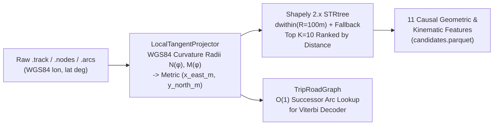

# PathSnap — Phase 1 Faculty Evaluation Presentation (5 Slides)

**Course:** UE24CS352A Machine Learning Hackathon (PES University)
**Team:** Qamar Ahmed (Tech Lead), Pranav Shashikiran Atreya (ML Eng), L A Gokul (Data Eng & Vis)

---

## Slide 1: Problem Statement & Verified Dataset Audit

- **Objective:** Reconstruct connected, realistic vehicle routes on a directed road network from noisy $1\text{ Hz}$ GPS trajectories using Machine Learning + HMM/Viterbi decoding.
- **Complete 90-Trip Dataset Audit (`data/dataset_inventory.csv`):**
  - **Partitions:** $80$ Training trips ($208,417$ GPS points) + $10$ Student-Test trips ($19,160$ GPS points); $10$ Evaluator-Test trips reserved server-side.
  - **Network Scale per Trip:** $649$ to $307,392$ directed arcs (median $18,761.5$); $0$ invalid node/arc references; $0$ isolated nodes.
  - **Geographic Span:** Multi-continent dataset ($\text{lon} \in [-100.42^\circ, 137.24^\circ]$, $\text{lat} \in [-34.64^\circ, 61.70^\circ]$).
  - **Key Telemetry Challenges Identified:**
    - Nominal $1\text{ s}$ sampling ($94.3\%$ mean exact $1\text{ s}$ steps), but **$47/90$ trips contain gaps $> 5\text{ s}$** and **$30/90$ trips contain gaps $> 30\text{ s}$**.
    - `.track` length ($N_{\text{obs}}$) never equals `.route` length ($M_{\text{route}}$), and $36/90$ routes contain repeated arcs (loops).

---

## Slide 2: Spatial Preprocessing & Candidate Generation Pipeline

- **Why Metric Projection?** At latitude $\sim 50^\circ\text{ N}$, $1^\circ$ longitude is $35.5\%$ shorter than $1^\circ$ latitude; our trip-centred WGS84 tangent-plane projection eliminates angular distortion.
- **Empirical Sensitivity Analysis (`data/sensitivity_analysis.csv` on $23,178$ Train Observations):**
  - At **$R = 100\text{ m}, K = 10$**: **Candidate Recall $= 99.73\%$** (**Candidate Miss Rate $= 0.27\%$**), averaging $8.48$ candidates per GPS point ($11.26\%$ positive class ratio).

---

## Slide 3: Causal Feature Engineering & Monotonic DP Label Alignment

- **11 Causal Features (`CANDIDATE_FEATURE_COLUMNS`):**
  - *Spatial Geometry (6):* `distance_to_segment_m`, `projection_fraction` $\in [0,1]$, `distance_to_start_m`, `distance_to_end_m`, `segment_length_m`, `segment_bearing_deg`.
  - *Causal Kinematics (5):* `delta_time_s`, `gps_speed_mps`, `gps_bearing_deg`, `bearing_difference_deg` $\in [0, 180]^\circ$, `is_fallback_candidate`.
  - *Noise & Gap Safeguards:* Stationary steps ($\Delta d < 2.5\text{ m}$), first observations ($i=0$), and GPS dropouts ($\Delta t > 30\text{ s}$) output nullable `<NA>` for heading/speed rather than fabricated noise.
- **Solving the `.route`-to-`.track` Alignment Problem (`align_reference_route`):**
  - Sequence-aware **Monotonic Dynamic Programming** over `(observation_id i, route_position j)` enforcing $j_i \ge j_{i-1}$.
  - Explicitly classifies every observation into `aligned` ($\le 50\text{ m}$, median residual $4.4\text{--}8.9\text{ m}$), `ambiguous`, `unmatched` (e.g. off-route trajectory tails), or `not_available`.
  - **Strict Miss Policy:** Candidate misses (`candidate_miss = True`) receive `label = <NA>` (`label_eligible = False`), never false-negative $0$ labels.

---

## Slide 4: Five Proposed ML Models & Algorithmic Justification

| # | Model | Family | Core Hypothesis & Justification | Probability Output for HMM |
|---|---|---|---|---|
| **1** | **Logistic Regression** | Linear / Probabilistic | Fast convex baseline testing monotonic log-odds decay with distance and bearing difference. | Calibrated sigmoid $P(y=1\mid\mathbf{x})$ under L2 log-loss. |
| **2** | **Distance-Weighted KNN** | Instance-Based | Non-parametric test of local similarity in standardized 11D geometric/kinematic space. | Inverse-distance weighted neighbour vote. |
| **3** | **Decision Tree** | Tree-Based | Captures interpretable conditional thresholds (e.g. bearing weight conditioned on speed $> 3\text{ m/s}$). | Smoothed leaf frequency (`min_samples_leaf >= 20`). |
| **4** | **Random Forest** | Bagging Ensemble | Reduces single-tree variance via bootstrap aggregation and feature subsampling at intersections. | Averaged forest leaf probabilities. |
| **5** | **HistGradientBoosting** | Gradient Boosting | Sequential log-loss minimisation with **native `NaN` routing** for stationary/dropout GPS points. | Native boosted logistic probability. |

---

## Slide 5: Experimental Methodology, Leakage Prevention & HMM Integration

- **Leakage-Free Validation Protocol:**
  - **5-Fold `GroupKFold` by `trip_id`** on the 80 training trips (zero shared trajectories between train and validation folds).
  - **Strict Inference Separation:** `generate_trip_candidates(...)` never reads `.route`; raw IDs (`trip_id`, `observation_id`, `candidate_arc_id`, `candidate_rank`) are excluded from model features.
- **Multi-Level Evaluation Metrics:**
  - *Candidate Level:* Macro F1, Precision, Recall, **Log Loss** (calibration quality).
  - *Observation Level:* **Observation-Level Top-1 Accuracy** & **Candidate Miss Rate**.
  - *Sequence Level:* **Route Continuity** (% connected transitions in `TripRoadGraph`) & end-to-end sequence match.
- **Bayesian Optimisation & Future Viterbi Integration:**
  - Best-performing model family undergoes Bayesian hyperparameter search on 5-fold Group CV.
  - Tuned classifier probabilities feed into our **Viterbi Decoder** over `TripRoadGraph` (`outgoing_arcs_by_node`), resolving parallel streets and intersection jumps into a continuous route.
