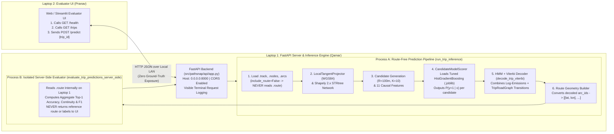

# PathSnap Phase 2 — Inference, HMM/Viterbi & Two-Laptop System Architecture

**Owner:** Qamar Ahmed (Technical Lead)
**Collaborators:** Pranav Shashikiran Atreya (ML Engineering & Evaluator UI), L A Gokul (Evaluation Framework & Visualisations)

---

## 1. End-to-End Two-Laptop Deployment & Inference Architecture

---

## 2. Strict Separation Between Prediction (Process A) and Server Evaluation (Process B)

To comply with Section 7 of `Assessment and Plagiarism Policy.pdf` and `Models and Training Guidelines.pdf`:

1. **Process A (`src/pathsnap/inference/inference_pipeline.py::run_trip_inference`):**
   - Calls `load_trip(..., include_route=False)` and asserts `raw.route is None`.
   - Generates spatial candidates, computes the 11 causal features (`CANDIDATE_FEATURE_COLUMNS`), scores candidates with `CandidateModelScorer`, and decodes the optimal connected path with `decode_trip_viterbi`.
   - Has **zero access** to `.route` files, reference alignments, or ground-truth labels.
2. **Process B (`src/pathsnap/inference/server_evaluator.py::evaluate_trip_predictions_server_side`):**
   - Invoked by the FastAPI endpoint **only after** `run_trip_inference` has returned the final `TripInferenceOutput`.
   - Reads `<trip_id>.route` internally on Laptop 1 (if present), computes aggregate evaluation scalars (`hmm_viterbi_top1_accuracy`, `classifier_only_top1_accuracy`, `hmm_viterbi_route_continuity`, `candidate_macro_f1`, `candidate_log_loss`, `hmm_viterbi_route_arc_f1`), and returns only the dictionary of scalar metrics.
   - Verified by `tests/test_inference_and_evaluator.py` (which spies on `load_route_file` to prove `0` calls during `run_trip_inference`) and `tests/test_api.py` (which verifies no reference route or label keys ever appear in `/trips` or `/predict` responses).

---

## 3. Module Boundaries & Responsibilities

| Package / Module | Responsibility | Key Interfaces |
|---|---|---|
| `src/pathsnap/data/loader.py` | Raw file loading & validation | `resolve_data_root()`, `load_trip(..., include_route=False)`, `validate_trip_arrays()` |
| `src/pathsnap/spatial/` | Metric projection, road network, `STRtree` candidate search | `LocalTangentProjector`, `build_trip_road_network()`, `generate_trip_candidates()` |
| `src/pathsnap/features/feature_engineering.py` | Causal GPS kinematics & heading difference | `compute_gps_kinematics()`, `compute_candidate_bearing_difference()` |
| `src/pathsnap/graph/road_graph.py` | Directed graph adjacency for HMM transitions | `TripRoadGraph`, `successor_arcs()`, `are_connected()`, `shortest_hop_transition_type()` |
| `src/pathsnap/inference/model_scorer.py` | Singleton model loading & schema-validated scoring | `CandidateModelScorer.from_path()`, `score_candidates()` |
| `src/sequence/viterbi_decoder.py` | Log-domain HMM + Viterbi route reconstruction | `ViterbiConfig`, `decode_trip_viterbi()`, `compute_log_transition_matrix()` |
| `src/pathsnap/inference/inference_pipeline.py` | End-to-end route-free prediction & geometry builder | `run_trip_inference()`, `arcs_to_segments_latlon()`, `TripInferenceOutput` |
| `src/pathsnap/inference/server_evaluator.py` | Post-inference server-side metric calculation | `evaluate_trip_predictions_server_side()`, `ServerEvaluationResult` |
| `src/pathsnap/api/app.py` & `schemas.py` | Laptop 1 FastAPI server (`GET /health`, `GET /trips`, `POST /predict`) | `create_app()`, `app` |
