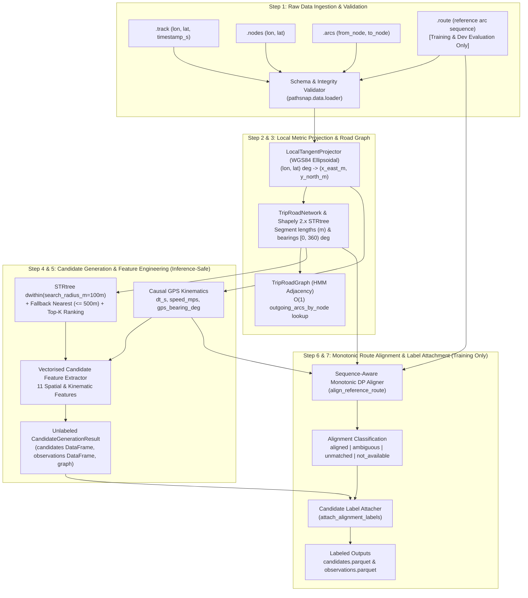

# PathSnap — Preprocessing, Spatial Engineering & Route Alignment Pipeline

**Authors:** Qamar Ahmed, Pranav Shashikiran Atreya, L A Gokul
**Repository:** `PathSnap-Map-Matching`

---

## 1. End-to-End Pipeline Architecture

---

## 2. Step-by-Step Input / Output Specifications

### Step 1: Data Ingestion & Quality Analysis (`src/pathsnap/data/loader.py`)
- **Input:** Trip directory `<data_root>/<partition>/<trip_id>/` resolved via `PATHSNAP_DATA_ROOT` or `../Student folder`.
- **Operations:**
  - Loads `<trip_id>.track` (`float64`, 3 columns: `longitude`, `latitude`, `timestamp_s`), `<trip_id>.nodes` (`float64`, 2 columns: `longitude`, `latitude`), `<trip_id>.arcs` (`int32`, 2 columns: `from_node_id`, `to_node_id`), and optionally `<trip_id>.route` (`int32`, 1D sequence of reference arc IDs).
  - Preserves 8-character zero-padded trip IDs (`"00000000"` .. `"00000099"`).
  - Validates finite coordinates, valid WGS84 bounds ($|\text{lon}| \le 180^\circ, |\text{lat}| \le 90^\circ$), monotonic timestamps, valid node indices ($0 \le u, v < N_{\text{nodes}}$), and valid route arc references ($0 \le a < N_{\text{arcs}}$).
- **Actual Dataset Audit Findings (All 90 Trips — 80 Train, 10 Student Test):**
  - **Total GPS Observations:** $227,577$ ($208,417$ in `train`, $19,160$ in `student_test`).
  - **Trajectory Length:** $262$ to $19,313$ observations per trip (median $1,496.5$).
  - **Road Network Scale:** $649$ to $307,392$ directed arcs per trip (median $18,761.5$).
  - **Geographical Distribution:** Global multi-continent dataset spanning longitudes $[-100.42^\circ, +137.24^\circ]$ and latitudes $[-34.64^\circ, +61.70^\circ]$ (Europe, North America, Asia, Australia, South America).
  - **Sampling Rate & Gaps:** Mean proportion of exact $1.0\text{ s}$ intervals across trips is $94.32\%$ (median $97.6\%$). However, **47 of 90 trips** contain GPS time gaps $> 5\text{ s}$, and **30 of 90 trips** contain gaps $> 30\text{ s}$ (up to $153,064\text{ s}$ during long parking/tunnel dropouts).
  - **Integrity:** Zero `NaN`/infinite coordinates, zero out-of-bounds node or arc references, and zero isolated road-network nodes across all 90 trips.

---

### Step 2: Geographic Preprocessing (`src/pathsnap/spatial/projection.py`)
- **Why Raw Degree Euclidean Distance Fails:**
  - Longitude and latitude are angular coordinates on an oblate spheroid. Because trips occur at latitudes ranging from $-34.6^\circ$ to $+61.7^\circ$, $1^\circ$ of longitude varies in physical length from $\sim 91.6\text{ km}$ down to $\sim 52.8\text{ km}$, whereas $1^\circ$ of latitude is $\sim 111.1\text{ km}$. Computing Euclidean distance or dot-product projections in raw degrees introduces severe anisotropic distortion (up to $52\%$ error in East-West vs North-South distances and bearings).
- **Local WGS84 Ellipsoidal Tangent-Plane Projection (`LocalTangentProjector`):**
  - Because each trip has its own self-contained road network (spatial extent $< 30\text{ km}$), we construct a trip-centred metric tangent projection around $(\lambda_0, \phi_0) = (\text{mean}(\text{lon}), \text{mean}(\text{lat}))$ using the exact WGS84 prime-vertical radius of curvature $N(\phi_0)$ and meridional radius of curvature $M(\phi_0)$:
    $$N(\phi_0) = \frac{a}{\sqrt{1 - e^2 \sin^2\phi_0}}, \quad M(\phi_0) = \frac{a(1 - e^2)}{(1 - e^2 \sin^2\phi_0)^{3/2}}$$
    $$x_{\text{east, m}} = (\lambda - \lambda_0) \cdot \frac{\pi}{180} N(\phi_0) \cos\phi_0, \quad y_{\text{north, m}} = (\phi - \phi_0) \cdot \frac{\pi}{180} M(\phi_0)$$
  - **Coordinate Order:** Strictly `(longitude, latitude)` in raw inputs and `(x_east_m, y_north_m)` in projected metric arrays; `(latitude, longitude)` is used only when rendering Folium HTML maps.
  - **Precision:** Internal projection and geometric dot products use `float64` to eliminate catastrophic cancellation; output features are stored in `float32` as required by the schema contract.

---

### Step 3: Road-Network Construction (`src/pathsnap/spatial/road_network.py`)
- **Input:** `nodes` (`(N_nodes, 2)`), `arcs` (`(N_arcs, 2)`), `LocalTangentProjector`.
- **Operations:**
  - Projects all node coordinates to `(x_east_m, y_north_m)`.
  - Constructs directed road vectors $\mathbf{v}_a = \mathbf{p}_{\text{to}(a)} - \mathbf{p}_{\text{from}(a)}$ for every arc $a \in \{0, \dots, N_{\text{arcs}}-1\}$.
  - Computes physical length $L_a = \|\mathbf{v}_a\|_2$ in metres and azimuth bearing $\theta_a = \text{atan2}(\Delta x_a, \Delta y_a) \bmod 360^\circ$ clockwise from True North.
  - Builds a `Shapely 2.x STRtree` over all metric road `LineString` geometries and a `TripRoadGraph` object mapping each node ID to its outgoing `arc_id` array.

---

### Step 4 & 5: Candidate Generation & Feature Engineering (`src/pathsnap/spatial/candidate_generation.py`)
- **Input:** `trip_id`, `partition`, `track`, `nodes`, `arcs`, `CandidateConfig`. (Never requires `.route`).
- **Spatial Indexing & Fallback Strategy:**
  1. Queries `strtree.query(gps_points, predicate="dwithin", distance=search_radius_m)` in a single vectorised C/GEOS call.
  2. For any GPS observation with zero road segments inside `search_radius_m`, if `enable_fallback_nearest=True`, queries `strtree.query_nearest(..., max_distance=500.0)` and sets `is_fallback_candidate = True`.
  3. Deduplicates `(observation_id, candidate_arc_id)` pairs, computes exact vectorised point-to-segment distances (`compute_point_to_segments_geometry`), sorts by `(observation_id, distance_to_segment_m, candidate_arc_id)`, and retains the top $K$ candidates (`candidate_rank = 1 .. K`).
- **Causal Feature Engineering (`src/pathsnap/features/feature_engineering.py`):**
  - Computes 11 physical and kinematic features without looking ahead to future timestamps:
    - Geometric: `distance_to_segment_m`, `projection_fraction` $\in [0, 1]$, `distance_to_start_m`, `distance_to_end_m`, `segment_length_m`, `segment_bearing_deg`.
    - Kinematic: `delta_time_s` ($t_i - t_{i-1}$), `gps_speed_mps` ($\Delta d_i / \Delta t_i$), `gps_bearing_deg`, `bearing_difference_deg` ($|\theta_{\text{gps}} - \theta_{\text{seg}}| \in [0, 180]^\circ$), and `is_fallback_candidate`.
  - **Anomaly Protection:** When $i = 0$, $\Delta t_i \le 0$, or $\Delta t_i > 30\text{ s}$ (long GPS gap), `gps_speed_mps`, `gps_bearing_deg`, and `bearing_difference_deg` are set to `NaN` (`<NA>`). When step displacement $\Delta d_i < 2.5\text{ m}$ (stationary vehicle jitter), `gps_bearing_deg` and `bearing_difference_deg` are set to `NaN` so random stationary noise never corrupts directional features.

---

### Step 6 & 7: Monotonic Route Alignment & Label Generation (`src/pathsnap/alignment/`)
- **Why Row-Index Alignment Fails:**
  - `.track` has $N_{\text{obs}}$ GPS points (e.g. $1,315$ in trip `00000001`), whereas `.route` has $M_{\text{route}}$ traversed road arcs (e.g. $525$ in trip `00000001`). A vehicle spends multiple seconds on long road segments, skips short intersection arcs between 1 Hz samples, and occasionally experiences GPS dropouts or off-network detours.
- **Monotonic Dynamic Programming Formulation (`align_reference_route`):**
  - Let $j \in \{0, \dots, M_{\text{route}}-1\}$ index the ordered occurrences in `.route` (preserving `reference_route_position` $j$ separately from `reference_arc_id` $\text{route}[j]$ because loops/U-turns can traverse the same arc twice).
  - **Emission Cost $E(i, j)$:** Combines squared point-to-segment distance $(d_{i,j} / \sigma_d)^2$ with a directional penalty when causal GPS heading is reliable.
  - **Transition Cost $T(j_{\text{prev}} \to j_{\text{curr}})$:** Enforces monotonic progression $j_{\text{curr}} \ge j_{\text{prev}}$:
    - Staying on the same route occurrence ($j_{\text{curr}} = j_{\text{prev}}$) is free unless the orthogonal projection moves backward by $> 5\text{ m}$.
    - Advancing across route occurrences ($j_{\text{curr}} > j_{\text{prev}}$) penalizes arc-length mismatch $|\Delta s_{\text{route}} - \Delta d_{\text{gps}}|$ and skipped arcs, scaled inversely with $\sqrt{\Delta t_i}$ so large GPS time gaps naturally allow larger route jumps.
  - **Confidence & Status Classification:**
    - `"aligned"`: $d_{i, j^*} \le 50\text{ m}$ and no non-adjacent competing route segment lies within $3\text{ m}$ of $d_{i, j^*}$ when $d_{i, j^*} > 20\text{ m}$.
    - `"ambiguous"`: $d_{i, j^*} \le 50\text{ m}$, but a non-adjacent route occurrence with a different arc ID has nearly identical distance.
    - `"unmatched"`: $d_{i, j^*} > 50\text{ m}$ (e.g., in Trip `00000002`, where the vehicle drives off the end of the recorded `.route` after observation $6,374$, reaching $> 300\text{ m}$ from any route arc).
    - `"not_available"`: No `.route` provided (inference mode).
- **Empirical Sensitivity Analysis (`data/sensitivity_analysis.csv` across 10 Training Trips, $23,178$ Observations):**

| Search Radius $R$ (m) | Max Candidates $K$ | Aligned Obs | Candidate Misses | Candidate Miss Rate | Candidate Recall | Avg Candidates / Obs | Positive Class Ratio |
|---|---|---|---|---|---|---|---|
| $30\text{ m}$ | $5$ | $22,193$ | $782$ | $3.524\%$ | $96.476\%$ | $3.84$ | $24.03\%$ |
| $50\text{ m}$ | $5$ | $22,193$ | $592$ | $2.668\%$ | $97.333\%$ | $4.32$ | $21.59\%$ |
| $50\text{ m}$ | $10$ | $22,193$ | $60$ | $0.270\%$ | $99.730\%$ | $7.08$ | $13.49\%$ |
| **$100\text{ m}$** | **$10$** | **$22,193$** | **$60$** | **$0.270\%$** | **$99.730\%$** | **$8.48$** | **$11.26\%$** |
| $100\text{ m}$ | $15$ | $22,193$ | $9$ | $0.041\%$ | $99.959\%$ | $11.68$ | $8.20\%$ |

We select **$R = 100\text{ m}, K = 10$** as our default configuration (`configs/default.yaml`): because `alignment_max_confident_distance_m = 50.0 m`, both $R=50\text{ m}$ and $R=100\text{ m}$ achieve the exact same **`99.73%` candidate recall (`60` rank-cap misses)** on confidently aligned observations, while $R=100\text{ m}$ retains connected road candidates during $50\text{--}100\text{ m}$ GPS drift so the downstream Viterbi decoder does not collapse to a single fallback candidate.
